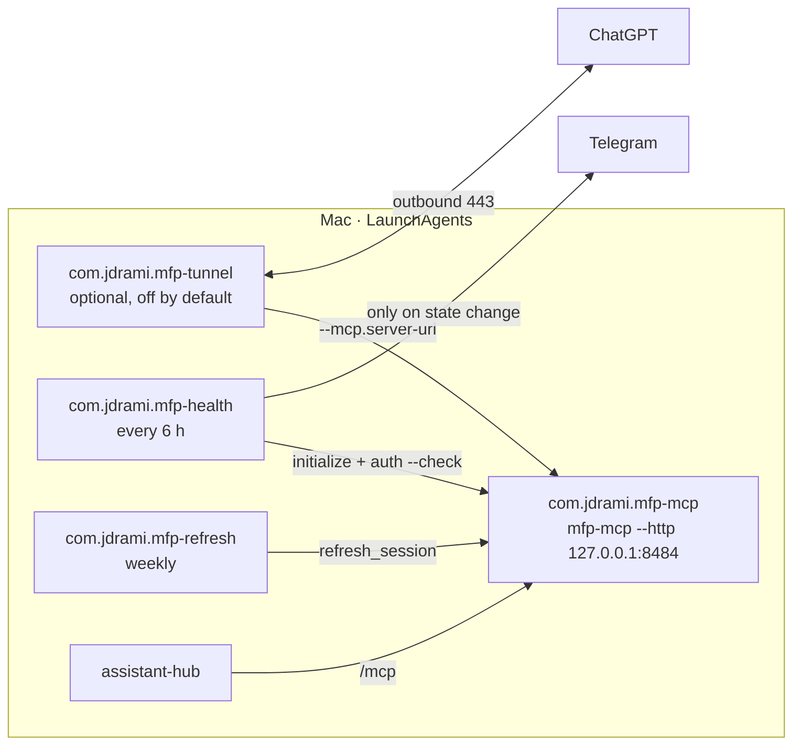

# mfp-weekly-sync (Mason on macOS)

Runs [Mason's MyFitnessPal MCP server](https://github.com/Mason-Levyy/myfitnesspal-mcp)
(`mfp-mcp`, pinned to upstream commit `640e79f` for the identical-entry delete
fix, until 0.4.2 is on PyPI) 24/7 on a Mac as **one shared, localhost-only
HTTP instance**. The [assistant-hub](docs/hub-integration.md) talks to it
directly. ChatGPT can reach it too through OpenAI's outbound-only tunnel, which
is optional and off by default.



## Security boundary

Mason has **no authentication**: anyone who can reach its port can read and
write your diary. So:

- It binds `127.0.0.1` only. `mfpctl` refuses to render any other host.
- Nothing listens on the network. The tunnel connects outbound to OpenAI.
- Whoever can use your ChatGPT tunnel connector can use the diary tools. Keep the
  tunnel disabled unless you want that.
- Secrets live only in `~/.config/mfp-mason/*.env` (mode 600), never in git,
  plists, argv or logs. The MyFitnessPal session cookie stays in Mason's own
  data folder (`~/Library/Application Support/myfitnesspal-mcp`, mode 700).

## Quick start (on the Mac that will run it)

```bash
git clone <this repo> ~/code/mfp-mason && cd ~/code/mfp-mason
scripts/install-mac.sh --username <mfp username>   # add --with-tunnel for ChatGPT access
# Recommended: the bot's own login (runbook step 4): MFP_LOGIN_EMAIL in mason.env, then
security add-generic-password -s mfp-login -a 'you@example.com' -w   # prompts for the password
bin/mfpctl login                  # at the Mac's screen: drives installed Chrome; click the Cloudflare box if shown
#   if Cloudflare still fails: log in (email + password) in a Chrome GUEST window, copy the full
#   Cookie request header, then: pbpaste | bin/mfp-auth   (or: bin/mfpctl login --manual)
# Fallback: pbpaste | bin/mfp-auth   (after copying the full Cookie request header)
bin/mfpctl install
sleep 20 && bin/mfpctl status     # Mason takes ~10 s to start
```

The full checklist, including Telegram alerts, the tunnel and retiring the old
Windows setup, is in [docs/mac-runbook.md](docs/mac-runbook.md).

## `mfpctl` reference

| Command | What it does |
|---|---|
| `mfpctl install` | Render, lint and load the Mason service, the 6-hourly health check and the weekly session refresh |
| `mfpctl uninstall` | Unload and remove every mfp-mason LaunchAgent; keeps data, session and logs |
| `mfpctl start` / `stop` / `restart` | Load or kickstart / unload / restart Mason in place |
| `mfpctl status` | launchd state of each agent plus a live MCP `initialize` probe |
| `mfpctl logs [-f]` | Show or follow `~/Library/Logs/mfp-mason/*.log` |
| `mfpctl rotation [N]` | Show MFP cookie-rotation events seen by the shim (names + hashes only) |
| `mfpctl health [--simulate-fail mcp\|auth\|tunnel]` | Run the health check now |
| `mfpctl login [--timeout S]` | Log the bot in with its own email + Keychain password, driving the installed Google Chrome via patchright (recommended) |
| `mfpctl login --manual` | Fallback when Cloudflare fails: log in by hand in Chrome, quit it (⌘Q), and the session is handed to Mason |
| `mfpctl auth [--username NAME]` | Re-authenticate from a piped cookie: `pbpaste \| mfpctl auth` (same as `bin/mfp-auth`) |
| `mfpctl refresh` | Rotate the MFP session now (also runs weekly, Sunday 04:30) |
| `mfpctl tunnel enable` / `disable` / `status` | Manage the optional ChatGPT tunnel |

Every mutating command accepts `--dry-run`, which prints the rendered plists and
`launchctl` calls without changing anything.

## Health alerts

`com.jdrami.mfp-health` runs every 6 hours (03:00, 09:00, 15:00, 21:00) and at login. It checks three things:

- Mason answers MCP `initialize`.
- `mfp-mcp auth --check` passes.
- When the tunnel is enabled, tunnel-client's `/readyz` returns 200.

It messages Telegram only when the state changes: 🔴 names the failing check
and how to fix it, and 🟢 says it recovered. Configure it in
`~/.config/mfp-mason/alert.env`; see `config/alert.env.example`.

## Session refresh

Mason refreshes the MFP session only when a call is rejected, and only by
sliding MFP's existing NextAuth session. It never redoes an SSO login.
`com.jdrami.mfp-refresh` also rotates it proactively every Sunday at 04:30 so
an idle session doesn't age out. A session that has fully expired or was
revoked is healed automatically: the health check tries a refresh, then (at
most once per 6 h) a password re-login with the bot's own credentials, and
alerts only if both fail. With its own login the bot doesn't share a session
with your browser or phone, so you can use MFP freely. The cookie-paste fallback
(`pbpaste | bin/mfp-auth`) stays tied to your browser session. See
[docs/mac-runbook.md](docs/mac-runbook.md#session-longevity-sso).

## Layout

```
bin/mfpctl                    service control
bin/mfp-auth                  piped-cookie (re)authentication (fallback)
scripts/login-mfp.sh          bot-owned password login (mfpctl login, auto re-login)
scripts/mfp_login.py          the login itself: patchright + installed Chrome, in its own venv/profile
scripts/save_session.py       hands the harvested cookies to Mason (save_cookies + seed_profile)
scripts/mason_entry.py        Mason's entry point, loading the cookie-rotation shim first
scripts/mason_cookie_shim.py  logs (optionally persists) MFP Set-Cookie rotations
scripts/install-mac.sh        idempotent installer: standalone uv, Python 3.13 (--dry-run, --with-tunnel, --username)
scripts/mason-run.sh          Mason entry point (loads mason.env, loopback only)
scripts/health-check.sh       6-hourly check + Telegram alert on state change
scripts/refresh-session.sh    weekly proactive session refresh
scripts/tunnel-run.sh         tunnel-client wrapper (reads tunnel.env)
scripts/lib/common.sh         shared helpers (bash 3.2 compatible)
launchd/*.plist.in            LaunchAgent templates
config/*.env.example          alert / tunnel / Mason settings templates
plans/                        weekly meal-plan schema, example, ChatGPT prompt (v2 input)
docs/                         runbook, Mason usage, hub integration, reconciliation rules
tests/*.bats                  offline test suite
```

## Development

Everything is tested offline: there's no account, no launchd and no writes to
`~/Library`. External commands are stubbed and every path is overridable.

```bash
make tools     # fetch pinned bats-core + shellcheck into .tools/
make verify    # shellcheck + plutil -lint of every template + bats
```

CI runs the same on `macos-latest`.

## Legacy

This repo used to contain `mfp-sync`, a Python CLI and MCP server that applied
weekly meal plans through mock, password and cookie-session backends. It was
superseded by Mason and removed. The full code is at the `legacy-mfp-sync` git
tag. Its lasting lessons are in
[docs/reconciliation-rules.md](docs/reconciliation-rules.md), and its plan
format is in [plans/](plans/).

## License

MIT. Not affiliated with or endorsed by MyFitnessPal. Mason uses undocumented
endpoints that can change at any time.
